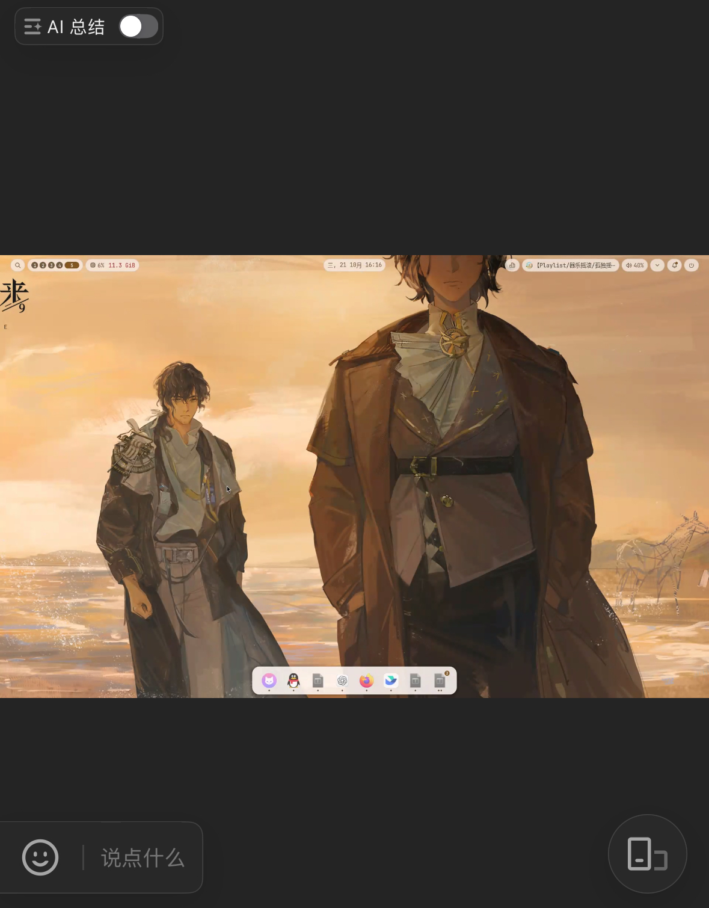

# Feishu Niri Screen Share｜飞书会议 Wayland 屏幕共享

让飞书（Feishu）Linux 客户端在 CachyOS + niri（Wayland）下共享整个显示器。项目包含完整的用户级 ScreenCast 后端源码、安装器和回退工具。已在飞书 Flatpak `cn.feishu.Feishu`、niri 26.04 与 PipeWire 1.6.9 上验证：另一台设备连续两次都能看到桌面。

## 工作原理

```text
niri 显示器 ── wlr-screencopy ── 本项目的 xdg-desktop-portal-wlr 后端
                                          │
                                      PipeWire 视频节点
                                          │
飞书会议 ←── 飞书自有的编码/发送模块 ←── 飞书 ScreenCast Portal 客户端
```

取帧思路与 [uu-remote-linux](https://github.com/VallierDev/uu-remote-linux) 的 niri 路径相同：都使用 niri 提供的 Wayland 屏幕采集接口。飞书会议有自己的编码、信令和发送逻辑，因此本项目通过标准 `xdg-desktop-portal`/PipeWire 接口把画面交给飞书，不使用 UU 的账号、云服务或 WebRTC 代码。

## 范围

- 支持指定一个显示器进行**整屏共享**，默认最高 30 FPS。
- 不提供远程鼠标/键盘控制，也不修改飞书客户端。
- 安装在当前用户的 `~/.local`，不替换系统 niri 或 PipeWire。
- `chooser_type=none`：点飞书“共享屏幕”后，后端直接选取配置的显示器；请确认该显示器没有不想分享的内容。

## 免责声明

本项目是社区独立制作的非官方工具，与飞书及其开发团队没有关联，也未获得其认可或技术支持。“飞书”仅用于说明本项目适配的客户端；项目不包含、不修改飞书的私有代码。

项目只在上文列出的环境中验证过整屏共享。飞书客户端、niri、Portal 或 PipeWire 更新后，行为可能变化；使用前请确认共享的显示器和内容，并以实际会议对端看到的画面为准。本项目不承诺兼容所有版本或桌面环境，也不提供飞书内置远程控制功能。

## 依赖

- 正在运行的 niri 会话、PipeWire、`xdg-desktop-portal`、`xdg-desktop-portal-gnome`。
- Python 3.10+、Meson、Ninja、pkg-config、C 编译器。
- 构建库：`libpipewire`、`wayland`、`wayland-protocols`、`libinih`、`mesa`、`libdrm`、`systemd-libs`。Arch/CachyOS 上这些包通常由桌面环境提供；缺少时由包管理器安装。
- 飞书 Linux 客户端；本项目已用 Flatpak `cn.feishu.Feishu` 验证。

## 使用

在项目根目录运行：

```bash
niri msg outputs
python3 -m feishu_niri_share install --output eDP-1 --fps 30
python3 -m feishu_niri_share status
```

把 `eDP-1` 换成第一条命令显示的实际输出名。安装命令会：

1. 编译随项目附带的 C 后端；
2. 安装程序、D-Bus 激活文件和 Portal 描述文件到 `~/.local`；
3. 备份现有用户配置，在 niri 会话的 Portal 配置中仅把 `ScreenCast` 指向 `wlr`；
4. 将后端配置为固定采集指定显示器；
5. 重启当前用户的 `xdg-desktop-portal.service`。

也可先在项目目录执行 `uv tool install .`，之后使用 `feishu-niri-share` 命令。无需安装 Python 包也可直接运行 `python3 -m feishu_niri_share`。构建产物写到 `~/.cache/feishu-niri-share/build`；安装记录和原文件备份在 `~/.local/state/feishu-niri-share`（遵循 `XDG_STATE_HOME`）。

## 验证

1. 在飞书会议中点“共享屏幕”，选择整屏共享。
2. 用手机或另一台设备加入会议，检查对端画面。
3. 停止共享并再次开始，确认第二次仍正常。

飞书本机会议窗口可能显示一块绿色的“正在共享”区域；它不是对端画面。对端画面或 PipeWire 视频源取帧才是有效验证。本机实测从后端视频节点取得完整 `1920×1200` 桌面帧，飞书输入与该节点的连接为 `active`。

### 效果展示

下图是飞书会议观看端收到的 niri 桌面共享画面。上下黑边来自观看窗口与共享桌面的宽高比不同。



## 飞书内置远程控制的现状

本项目目前**不能**让会议对端通过飞书内置的“远程控制”操作 niri。飞书帮助中心的[屏幕共享说明](https://www.feishu.cn/hc/en-US/articles/360046586533-share-your-screen)明确指出 Linux 设备不支持远程控制，相关菜单不可用。本机所装飞书 Flatpak 7.72.23 的 `libbyteview-bytertc.so` 虽然导出 `GetRemoteControlEngine` 等函数，但其中有名为 `RemoteControlEngineFake` 的类型；该对象的多个虚函数只是直接返回，不能据此认为客户端已接收并处理对端键鼠事件。

共享画面使用 ScreenCast Portal/PipeWire，远程键鼠需要飞书客户端先在会议中协商控制权限、接收控制事件，再把事件送给本机输入后端。单独增加 niri 输入模拟程序或打开 RemoteDesktop Portal，无法让飞书内置菜单自动出现或让其专有事件到达该程序。因此，在飞书提供 Linux 远程控制支持或可用的控制事件接口之前，这项功能不应标记为已实现。详见[架构说明](ARCHITECTURE.md#飞书内置远程控制的接入条件)。

## 回退

```bash
python3 -m feishu_niri_share uninstall
```

回退会恢复安装前的 Portal 配置和本项目覆盖过的用户级文件。如果安装后你又手动修改了其中某个文件，回退会保留该文件并报告路径，避免丢失新改动。它不卸载系统依赖或飞书。

## 源码与许可

`feishu_niri_share/backend/` 是 [xdg-desktop-portal-wlr](https://github.com/emersion/xdg-desktop-portal-wlr) 源码，固定来源提交 `c0255d7b047b7263629ab5a314661045ff7f65e3`，保留其 MIT 许可文件。外层安装工具也采用 MIT 许可。项目不包含 UU 或飞书的私有代码。详见 [架构说明](ARCHITECTURE.md)。

## 喜欢这个项目？

如果它让你的 niri 桌面顺利出现在飞书会议里，欢迎点颗 ⭐ Star。星星不会修好所有兼容问题，但会让维护者开心得像终于选对了 Portal 后端。
